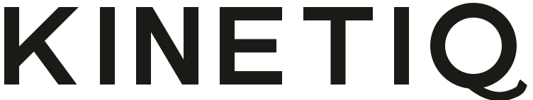

# Kinetiq

Formerly KinetiSense (renamed 2026-10-24; the repository keeps its old name).

A wearable motion tracker for youth and high school baseball pitchers. It straps to the outer forearm and is meant to record forearm angular velocity during throws, then show each throw in a web app.

Built by Arnav Chouksey and Vatsalya Vishnoi for the Congressional App Challenge and eCYBERMISSION.

## Status

Early stage (2026-09-30). Parts are ordered and have not arrived. No real sensor data exists yet. The only data in this repo's tooling is a synthetic generator for practice. Nothing here measures pitch speed, and nothing here has been validated.

## Where to find things

| What | Link |
|---|---|
| How training data is made, labeled and used honestly | [docs/data_plan.md](docs/data_plan.md) |
| Verified facts, corrections, open questions | [docs/verification_log.md](docs/verification_log.md) |
| Every AI contribution, by session | [AI_USAGE.md](AI_USAGE.md) |
| Working rules for the AI coach | [CLAUDE.md](CLAUDE.md) |
| ML and analysis (setup instructions) | [ml/README.md](ml/README.md) |
| Python packages for ML | [ml/requirements.txt](ml/requirements.txt) |
| Practice data generator (fake data) | [ml/tools/make_synthetic_session.py](ml/tools/make_synthetic_session.py) |
| Data folder rules and privacy | [data/README.md](data/README.md) |
| Session metadata template | [data/sessions_template.csv](data/sessions_template.csv) |
| Firmware (Pico 2 W) | [firmware/README.md](firmware/README.md) |
| Web app, including the Ask AI tab and how to add the Groq key | [web/README.md](web/README.md) |

## Notebooks

None yet. The first one is the student-written analysis that loads and plots IMU data. It will be linked here once it exists.

## Rules this project follows

- The ML core is written by the student team. AI is used as a teacher and reviewer, plus boilerplate and some web app parts (the reference viewer, the Ask AI tab, the logo redraw). Every one of them is listed in [AI_USAGE.md](AI_USAGE.md).
- The Ask AI tab itself uses an AI model (run by Groq) to explain the numbers. It only gets numbers, and it is told not to estimate pitch speed, give medical advice, or grade throws.
- Claims are limited to what data supports. No "measures pitch speed" without radar validation, no injury prevention claims, and no comparison claiming to beat other products.
- No names, faces or video of minors are committed. Throwers get anonymous IDs.
